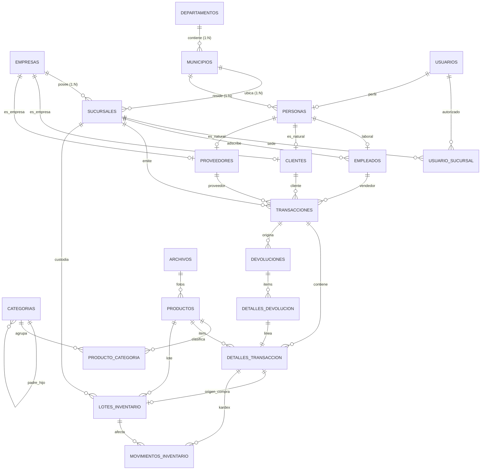

# Modelo Entidad-Relación - Sistema Weber (v2.0 Auditado)

Modelo relacional y diccionario de datos para el sistema de comercialización, facturación y control de inventario con rotación y valuación **FIFO** (First-In, First-Out) de la empresa **Weber**.

Repositorio oficial: [EjemplosADSI/MER_Weber](https://github.com/EjemplosADSI/MER_Weber)

---

## 1. Contexto del Negocio y Problemática

La empresa **Weber** se dedica a la comercialización de víveres y productos alimenticios. Debido a su crecimiento, enfrenta desafíos críticos en la gestión de la información entre su sede administrativa principal y sus diferentes sucursales/bodegas.

### Requerimientos Clave del Sistema:
1. **Multi-Sucursal e Inventario Descentralizado**: Cada sucursal opera de manera independiente con su propio inventario físico y catálogo de precios.
2. **Control de Lotes y FIFO Estricto**: Todo ingreso de mercancía por compra registra un número de lote, costo de compra y fecha de vencimiento. Las ventas despachan automáticamente las unidades del lote más antiguo próximo a vencer.
3. **Catálogo Flexible y Categorías**: Un producto puede pertenecer a múltiples categorías, indicando cuál es su categoría principal.
4. **Separación de Roles**:
   - **Administrador**: Gestiona los pedidos a proveedores y la información de sus sedes asignadas.
   - **Empleado/Vendedor**: Registra ventas en el punto de venta (POS) y procesa devoluciones.
   - **Clientes y Proveedores**: Identificados como personas naturales o empresas jurídicas con NIT.
5. **Devoluciones Controladas**: Registro de productos devueltos con reintegro al cliente y reincorporación o merma en el inventario.

---

## 2. Auditoría y Mejoras de la Versión 2.0

En esta versión se resolvieron inconsistencias críticas detectadas en el diseño inicial:

| Aspecto | Versión Anterior (v1.0) | Versión Optimizada (v2.0) |
|---|---|---|
| **Multi-Sucursal** | `UNIQUE(empresa_id)` impedía tener más de 1 sucursal por empresa. | Corregido a `UNIQUE(empresa_id, codigo)` para soportar ilimitadas sucursales. |
| **Categorías** | `categoria_id` en `productos` entraba en conflicto con `producto_categoria`. | Normalizado a `producto_categoria (producto_id, categoria_id, es_principal, orden)`. |
| **Gestión FIFO** | Se mezclaba el lote y el stock disponible en `detalles_transaccion`. | Desacoplado en: 1) `detalles_transaccion` (facturación), 2) `lotes_inventario` (lotes físicos), 3) `movimientos_inventario` (Kardex FIFO). |
| **Devoluciones** | Solo permitía devolver 1 producto por documento de devolución. | Separado en cabecera `devoluciones` y detalle `detalles_devolucion` multi-ítem. |
| **Actores del Sistema** | Monolito `perfiles_usuario` mezclaba clientes, proveedores y empleados. | Estructurado en: `personas` (base humana), `empleados`, `clientes` y `proveedores` (naturales o jurídicos). |
| **Autenticación** | `usuario_id` referenciaba una tabla que no existía. | Incorporada la tabla `usuarios` con roles, control de contraseñas y scoping `usuario_sucursal`. |
| **Auditoría** | No existían marcas temporales. | Agregados `creado_en`, `actualizado_en` y `eliminado_en` (soft delete) en todas las entidades. |

---

## 3. Diagrama Entidad-Relación (Mermaid)



---

## 4. Vistas SQL Incluidas

1. **`v_disponibilidad_fifo`**:  
   Muestra los lotes activos con unidades disponibles, ordenados cronológicamente por vencimiento y fecha de ingreso, alertando sobre lotes próximos a vencer (30 días) o vencidos.
2. **`v_inventario_sucursal`**:  
   Consolida las existencias actuales de cada producto por sucursal frente a sus umbrales de stock mínimo y máximo, clasificando en *Normal*, *Stock Bajo* o *Agotado*.
3. **`v_rentabilidad_productos`**:  
   Calcula ingresos, costos reales según Kardex FIFO y la utilidad bruta generada por producto y sucursal.
4. **`v_todas_transacciones`**:  
   Visor unificado de compras y ventas con el nombre formateado de clientes, proveedores y empleados.

---

## 5. Instrucciones de Uso

Para desplegar el esquema en MySQL 8.0+:

```bash
mysql -u root -p < Script.sql
```

Para entornos PostgreSQL / Python, consulte el proyecto monorepo oficial: [weber](https://github.com/Daom-Projects/weber).
